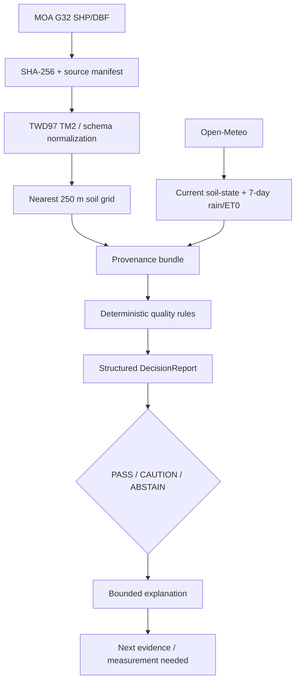

# SoilTrust V0.2 Architecture

## Design invariant

**No explanation layer may upgrade the evidence state.**

If the deterministic layer says `ABSTAIN`, a later AI layer may explain why, but it cannot convert that state into a recommendation.

## Pipeline

## Trust boundaries

### G32

Trusted for: official public-source identity, declared 250 m grid, published chemistry attributes when correctly mapped.

Not automatically trusted for: current field state, exact within-field variability, unknown sample date, crop-specific recommendations.

### Open-Meteo

Trusted for: a reproducible public model-data API response and declared variable semantics.

Not automatically trusted for: local sensor truth, exact field-scale soil moisture, a fixed spatial resolution when the response does not identify the model/resolution.

### SoilTrust

Trusted for: deterministic checks implemented in source code, provenance capture, fail-closed behavior.

Not proof of: agronomic efficacy or decision correctness.
